

<a href="https://www.merathilisui.com/">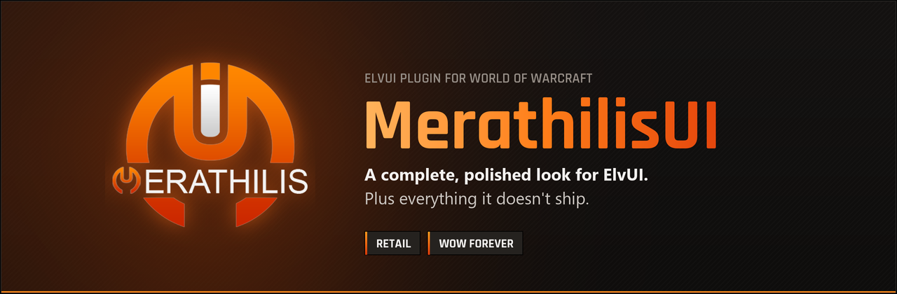</a>

 

   

    

   

**[Website](https://www.merathilisui.com/)** &nbsp;·&nbsp;
**[Download](https://www.merathilisui.com/download)** &nbsp;·&nbsp;
**[Features](https://www.merathilisui.com/features)** &nbsp;·&nbsp;
**[Presets](https://www.merathilisui.com/presets)** &nbsp;·&nbsp;
**[Changelog](https://www.merathilisui.com/changelog)** &nbsp;·&nbsp;
**[Discord](https://discord.com/invite/28We6esE9v)**

 

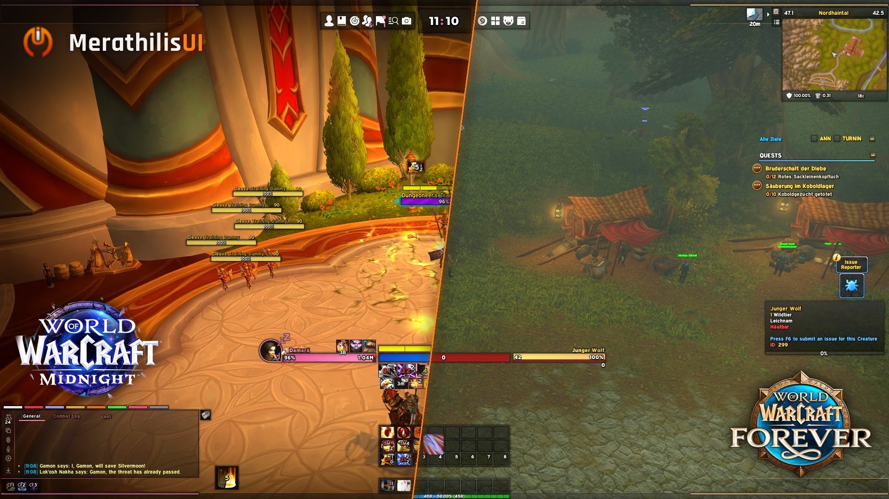

Screenshot also shows other AddOns.

MerathilisUI is a plugin for **ElvUI** on **Retail** and **WoW Forever**. It gives your interface a clean, transparent design with class-colored gradients and adds a set of modules that go beyond what ElvUI offers out of the box. Everything is modular: turn off what you don't need, keep the rest.

> [!NOTE]
> Support for WoW Forever is still a work in progress. A few modules (e.g. the Armory) are not available there yet.

| Why MerathilisUI? | |
| --- | --- |
| 🧭 **One-click complete UI** | The installer sets up ElvUI, chat, action bars, data texts, nameplates, unit frames and profiles for popular addons. Pick **General**, **Dark** or **Gradient**. |
| 🎨 **One design everywhere** | Blizzard windows, ElvUI and supported addons get the same shadows, gradients and flat widgets, including the ElvUI options window itself. |
| 🧩 **Features ElvUI doesn't have** | Categorized bags, a full Armory, AddOn and Loadout Manager, click-casting, a chat sidebar, Mythic+ info on hover, a buff reminder and more. |
| 🔧 **Actively maintained** | Regular updates for the current patch, and bugs reported on Discord get fixed. |

 

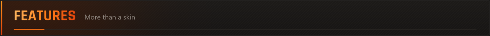

<table>
	<tr>
		<td width="50%">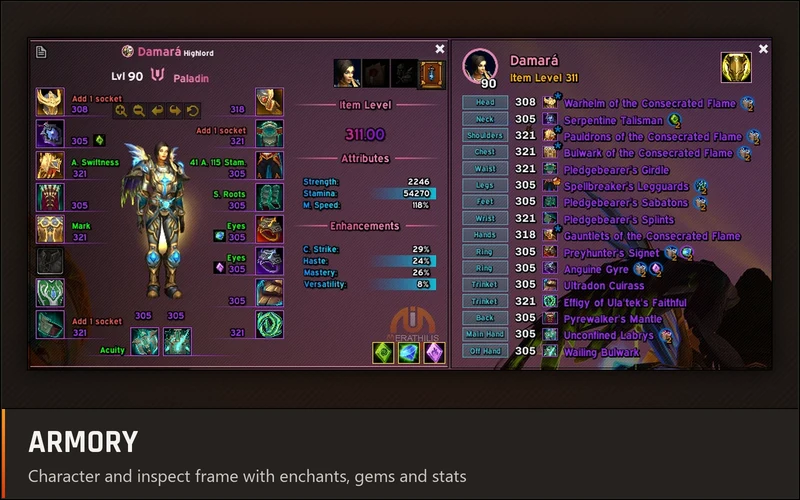</td>
		<td width="50%">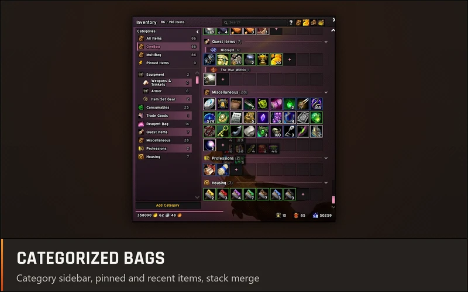</td>
	</tr>
	<tr>
		<td>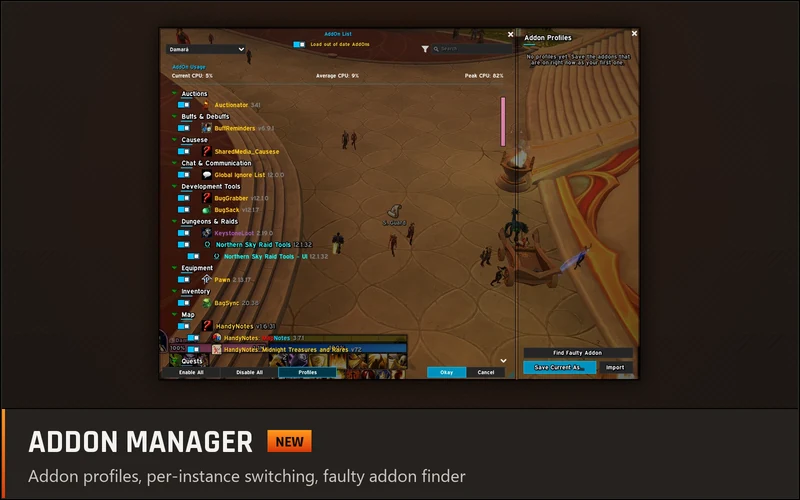</td>
		<td>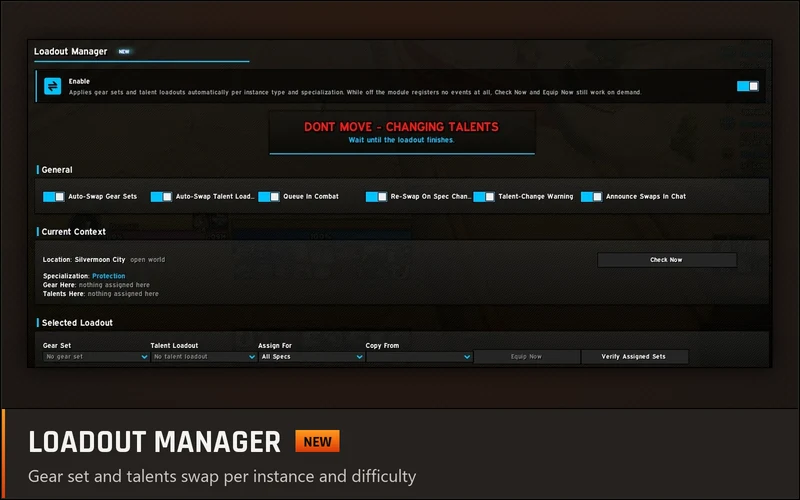</td>
	</tr>
	<tr>
		<td>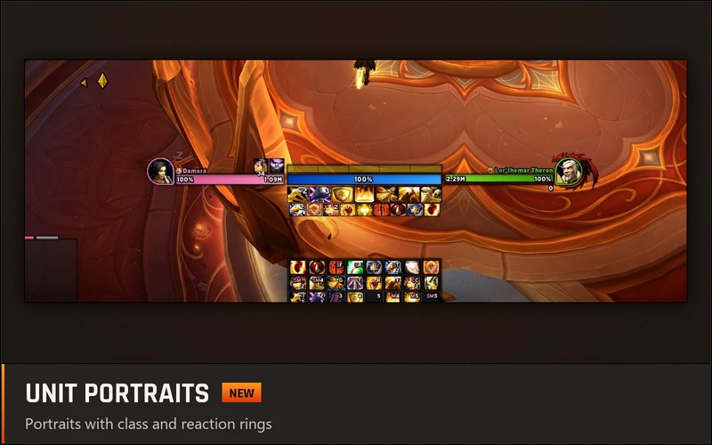</td>
		<td>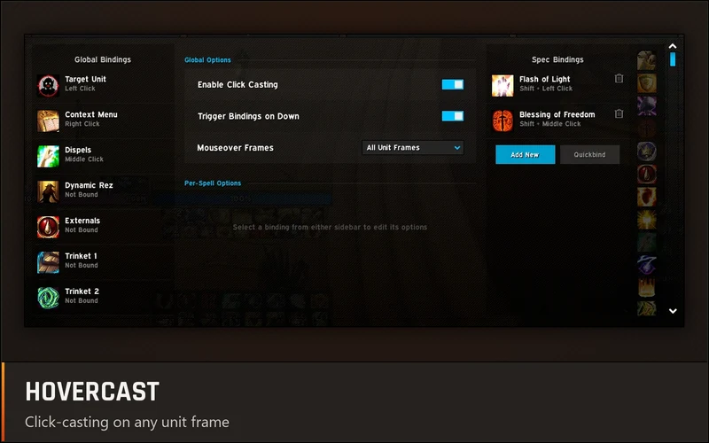</td>
	</tr>
	<tr>
		<td>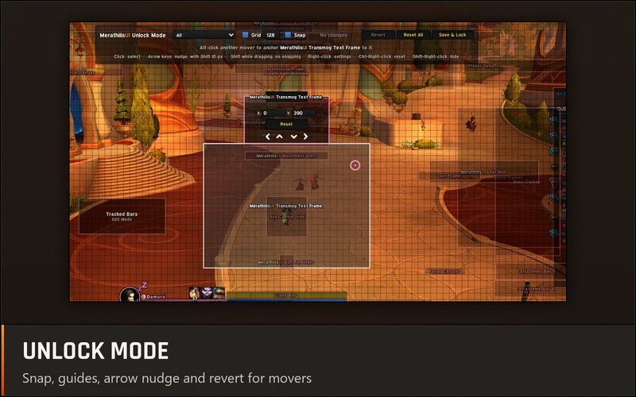</td>
		<td>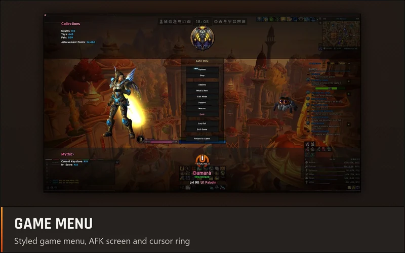</td>
	</tr>
	<tr>
		<td>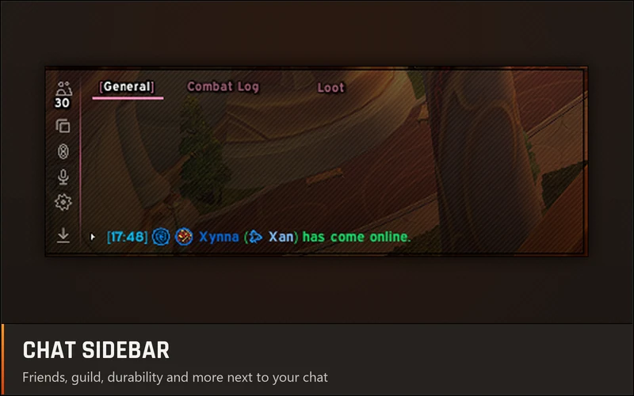</td>
		<td>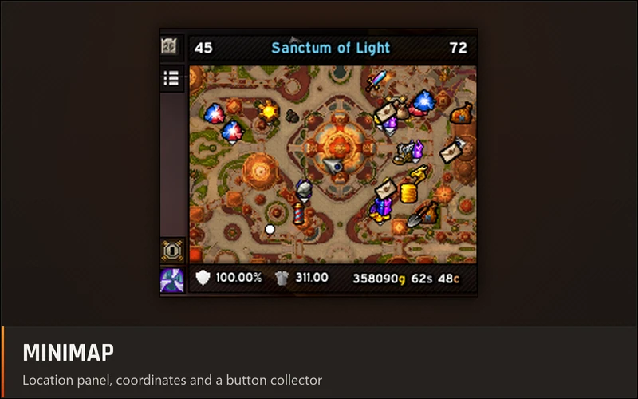</td>
	</tr>
	<tr>
		<td>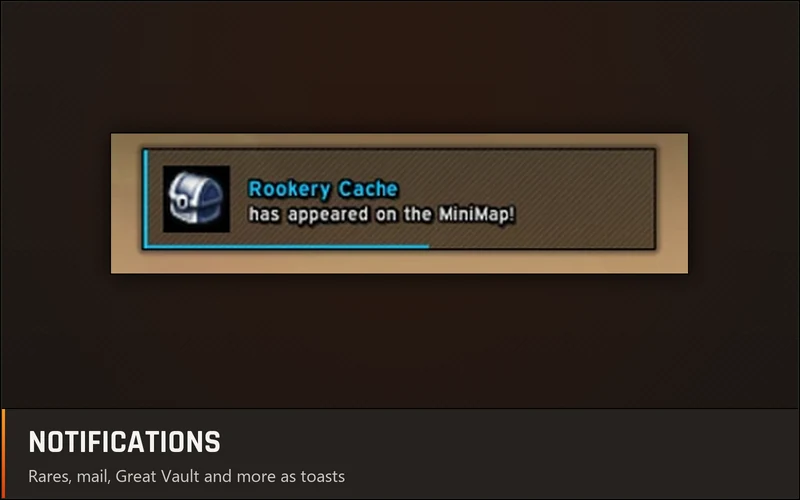</td>
		<td>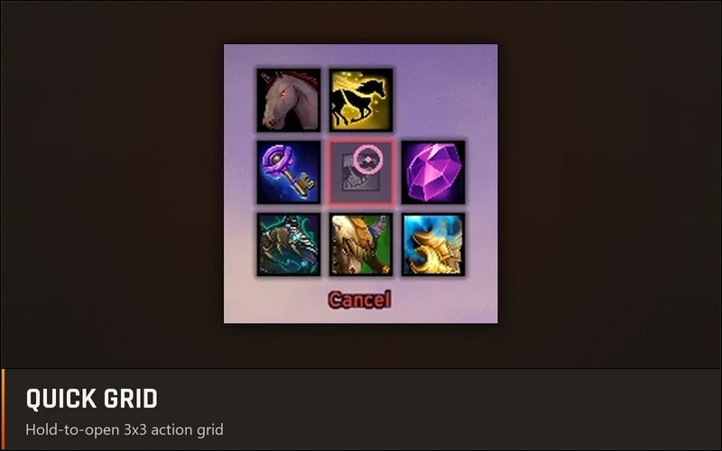</td>
	</tr>
</table>

<b>Show the full feature list</b>

### Bags

-   **Categorized Bags** - Replaces the bag frame with a category sidebar: pinned and recent items, custom categories, sub-headers per expansion and per equipment set
-   Merges identical stacks into one slot and shrinks the bag and bank windows to fit their contents
-   Shows which items are part of an equipment set

### Armory (Character Frame)

-   Redesigned character and inspect frame with class backgrounds
-   Item level, enchants and sockets per slot, with a warning for missing enchants
-   Shows the highest item level you can reach with the items in your bags
-   Built-in equipment set manager and socket panel

### Chat & Minimap

-   **Chat Sidebar** - Friends and guild online, durability, voice chat and copy chat in one bar next to the chat
-   **Location Panel** - Zone text and coordinates above the minimap
-   **Minimap Button Bar** - Collects the addon buttons from your minimap into one bar

### Combat & Group Content

-   **NameHover** - Unit info at your cursor; in Mythic+ it shows how much Enemy Forces an enemy is worth and your current pull progress
-   **Buff Reminder** - Reminds you of missing raid buffs, flasks, food, runes, weapon enchants and poisons
-   **Movement Alert** - Shows the cooldowns of your movement spells, optionally with Text to Speech
-   **Loot Spec Manager** - Switches your loot specialization automatically per boss in raids and Mythic+
-   **Spec Bar** - Switch your specialization with one click
-   **Vehicle / Skyriding Bar** - Styled vehicle bar with a vigor bar and speed display
-   **Faction Indicator** - Faction crest of the opposing faction on unit frames and nameplates

### Notifications

-   Rare mobs, new mail, Great Vault rewards, Call to Arms, low durability, full bags, guild events, Quick Join requests and currency cap warnings

### Quality of Life

-   Mail: open or delete multiple mails at once, send templates and quick attach
-   Profession tabs, Pet Journal filter by type, tertiary stats in the auction house
-   Copy your current transmog as a list, Wowhead links in the Achievement and World Map frame
-   Styled game menu, AFK screen and cursor ring with GCD and cast progress

### Unit Frames & Theme

-   Gradient, Dark and class-colored health, power and castbars
-   Additional styling for player, target, party, raid and boss frames

 

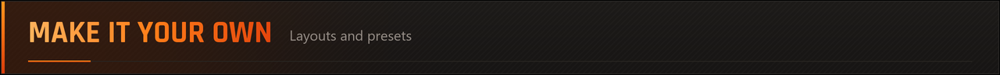

The installer comes with three layouts - **General**, **Dark** and **Gradient**. On top of that you can apply a **preset**: a ready-made look shared as a code, in game on the Presets page or from the [preset gallery](https://www.merathilisui.com/presets).

<table>
	<tr>
		<td width="50%">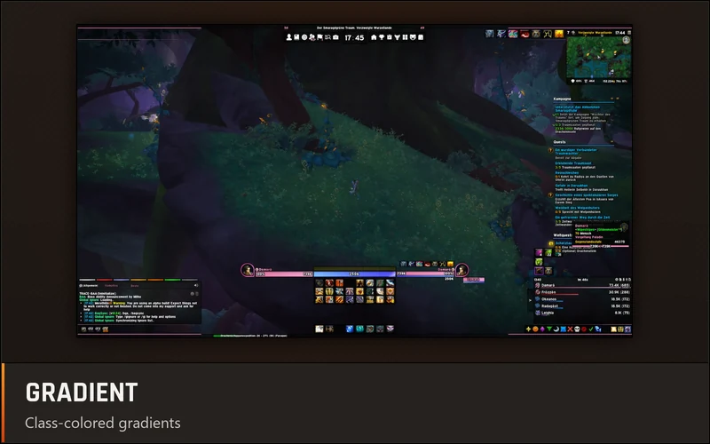</td>
		<td width="50%">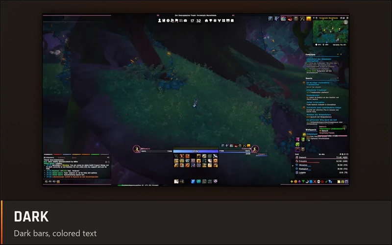</td>
	</tr>
	<tr>
		<td>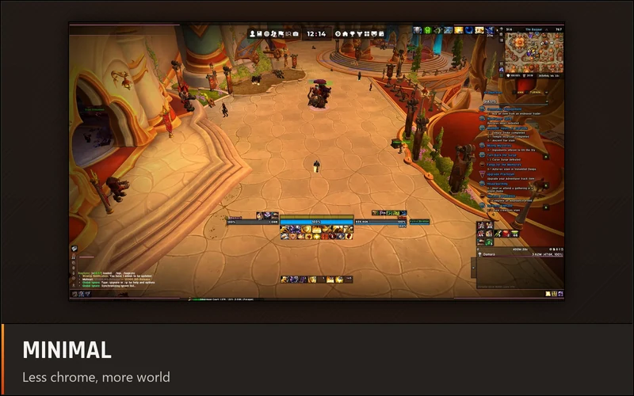</td>
		<td>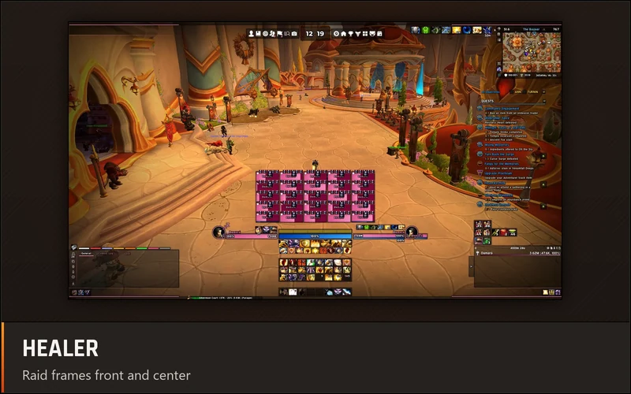</td>
	</tr>
</table>

 

| Step | |
| :---: | --- |
| **1** | **Install the requirements** - [ElvUI](https://tukui.org/elvui) and [ElvUI_WindTools](https://www.curseforge.com/wow/addons/elvui-windtools). |
| **2** | **Install MerathilisUI** - from [CurseForge](https://www.curseforge.com/wow/addons/merathilis-ui), [Wago](https://addons.wago.io/addons/elvui-merathilisui), [WowUp](https://wowup.io/addons/2797823) or the [GitHub releases](https://github.com/Merathilis/ElvUI_MerathilisUI/releases). |
| **3** | **Run the installer** - it starts on your first login. Pick a layout and skip any step you want to keep, or apply a preset instead. |

> [!TIP]
> Apply MerathilisUI to a new ElvUI profile, then you can always switch back. You can open the installer again at any time with the **Install** button in the MerathilisUI options.

> [!WARNING]
> Running the installer again after an update overwrites your own changes in the steps you apply.

 

| | AddOn |
| --- | --- |
| **Required** | [ElvUI](https://tukui.org/elvui) · [ElvUI_WindTools](https://www.curseforge.com/wow/addons/elvui-windtools) |
| **Recommended** | mMediaTag & Tools |

 

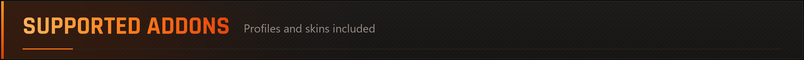

**Profiles included for** 
BigWigs · Details! · ls: Toasts · Capping · TomTom · Permoks Account Manager · Skiron Cooldown Manager · WindTools · mMediaTag · Blizzard Edit Mode layout

**Skins included for** 
BigWigs · Details! · BugSack · BagSync · Capping · Clique · ls: Toasts · Pawn · WIM · WowLua · Paragon Reputation · KeystoneLoot · and more

 

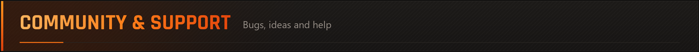

Join the [Discord](https://discord.com/invite/28We6esE9v) and read the bug report guidelines before posting. A good report (error message, steps to reproduce, list of your addons) helps a lot. You can also open an [issue](https://github.com/Merathilis/ElvUI_MerathilisUI/issues) here on GitHub or share an idea on the [website](https://www.merathilisui.com/ideas).

If you like MerathilisUI and want to support its development:

   

 

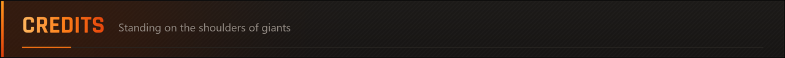

Special thanks to Benik for the help from the very beginning, and to Elv, Simpy, DarthPredator, Blazeflack, Azilroka and all other addon authors whose work inspired MerathilisUI. See [CREDITS.md](CREDITS.md) for the full list.

 

 
Made with ♥ by Merathilis · <a href="https://www.merathilisui.com/">merathilisui.com</a> · <a href="LICENSE.txt">MIT License</a>

